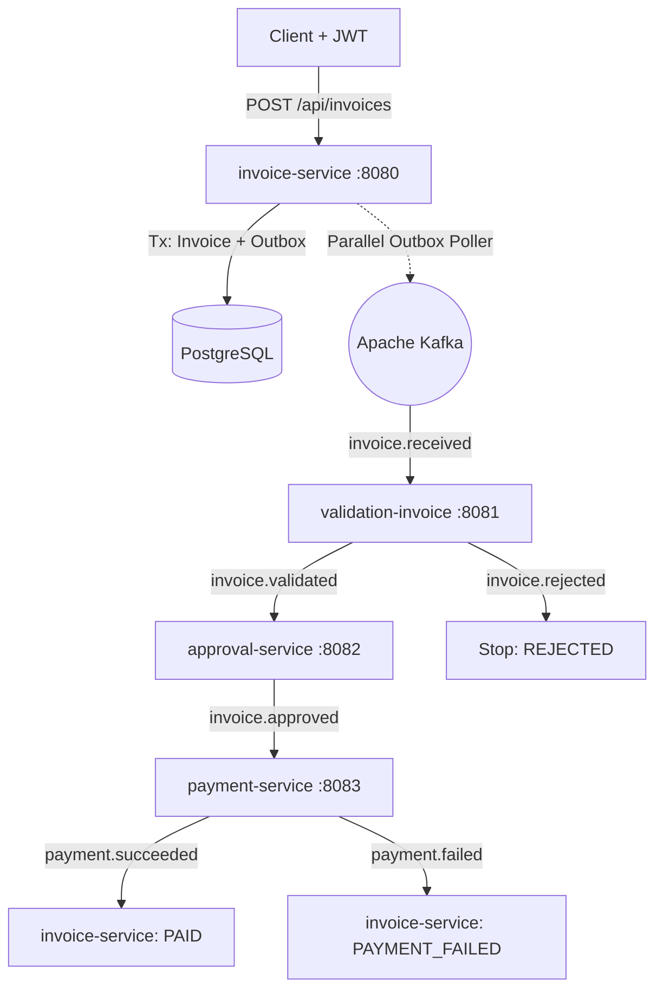

# E-Invoicing Platform

Event-driven, multi-module backend for processing European-style SME e-invoices built with **Java 21**, **Spring Boot**, **PostgreSQL**, and **Apache Kafka**.

**End-to-End Flow:** `receive` → `validate` → `approve` → `pay` → `update status`

Designed with **Hexagonal Architecture (Ports & Adapters)** to keep core domain logic strictly decoupled from web, persistence, and messaging infrastructure. Local runtime uses Docker Compose; Azure Bicep templates under `infra/azure/` provide a cloud deployment target.

---

## Architecture & Event Flow



### Services

| Service | Port | Responsibility |
| :--- | :---: | :--- |
| **`invoice-service`** | `8080` | REST intake, JWT auth, Transactional Outbox publisher, Inbox deduplication, final state updates |
| **`validation-invoice`** | `8081` | Business & VAT validation rules on `invoice.received` |
| **`approval-service`** | `8082` | Automated and manual invoice approval workflows |
| **`payment-service`** | `8083` | Payment execution with Resilience4j fault tolerance and idempotency |

---

## Reliability & Data Consistency

| Engineering Concern | Implementation |
| :--- | :--- |
| **Dual-Write Prevention** | **Transactional Outbox** pattern persisting domain state and outbox events atomically in PostgreSQL. |
| **At-Least-Once Deduplication** | **Transactional Inbox** (`processed_events` with unique `eventId` constraints) in `invoice-service` and `payment-service`, paired with idempotent state transitions. |
| **HTTP Request Idempotency** | Optional `Idempotency-Key` header on `POST /api/invoices`; duplicate keys safely return the existing invoice and current status. |
| **Payment Fault Tolerance** | **Resilience4j** retry, circuit breaker, and fallback policies protecting against downstream provider latency or failures. |
| **Poison Pill Isolation** | Dead-Letter Topics (`*.DLT`) configured on Kafka consumers after exhausting retries. |
| **End-to-End Traceability** | W3C `traceparent` propagation across HTTP, Outbox rows, and Kafka headers, correlated with `X-Correlation-Id` in structured logs. |

Additional architecture notes: [`docs/FAILURE_MODES.md`](docs/FAILURE_MODES.md)

---

## Performance & Concurrency Engineering (k6 Benchmarks)

To prevent the Transactional Outbox from becoming an asynchronous bottleneck under load, the ingestion and publishing pipeline was iteratively benchmarked using **k6** (25 Virtual Users, 25s sustained load) across all 4 microservices:

1. **Decoupled Transaction Boundaries (`TransactionTemplate`):** Removed method-level `@Transactional` around Kafka broker acknowledgments (`allAcks.get()`), preventing HikariCP connection pool starvation during network I/O.
2. **Parallel Outbox Dispatch (`CompletableFuture.allOf`):** Replaced sequential `send().get()` calls with parallel batch publishing (250 events/batch) combined with Hibernate JDBC batch updates (`hibernate.jdbc.batch_size=50`, `order_updates=true`).
3. **Java 21 Virtual Threads & Partition Concurrency:** Enabled Virtual Threads (`spring.threads.virtual.enabled=true`), sized HikariCP pools per service, and scaled Kafka listener concurrency (`concurrency=3`) across topic partitions.

| Benchmark Stage | Configuration | Throughput | `p90` Latency | `p95` Latency | Error Rate | Key Finding |
| :--- | :--- | :---: | :---: | :---: | :---: | :--- |
| **1. Baseline** | Sequential outbox (50/2s), 10 DB conns | `107.9 req/s` | `54.5 ms` | `85.6 ms` | `0.00%` | Fast HTTP intake, but ~2-minute async outbox backlog under load. |
| **2. Parallel + Long Tx** | Parallel batch (250), `@Transactional` over Kafka I/O | `49.8 req/s` | `548.1 ms` | `874.9 ms` | `0.00%` | Holding DB connections during broker ACKs starved HTTP threads. |
| **3. `TransactionTemplate`** | Short DB micro-transactions + parallel Kafka I/O | `59.1 req/s` | `302.4 ms` | `381.5 ms` | `0.00%` | Released HikariCP connections immediately; full pipeline ran live. |
| **4. Fully Tuned** | Virtual Threads, HikariCP 15–20, `concurrency=3` | **`80.0 req/s`** | **`148.6 ms`** | **`192.0 ms`** | **`0.00%`** | Balanced end-to-end throughput across all 4 services with zero backlog. |

---

## Tech Stack

| Layer | Technologies |
| :--- | :--- |
| **Core** | Java 21 (Virtual Threads, Records), Spring Boot 3, Maven (Multi-module) |
| **Data & Migrations** | PostgreSQL, Spring Data JPA / Hibernate (JDBC Batching), Flyway |
| **Messaging & Resilience** | Apache Kafka, Transactional Outbox/Inbox, Resilience4j |
| **Observability** | OpenTelemetry, Jaeger (Distributed Tracing), Micrometer, Prometheus, Grafana |
| **Security & API** | Spring Security, Stateless JWT, OpenAPI / Swagger UI |
| **Testing & DevOps** | JUnit 5, Testcontainers / Integration Tests, k6, Docker Compose, GitHub Actions, Azure Bicep |

---

## Quick Start

### 1. Start Infrastructure

```bash
docker compose up -d
```

Starts PostgreSQL, Apache Kafka, Jaeger (`localhost:16686`), Prometheus (`localhost:9090`), and Grafana (`localhost:3000`).

### 2. Build & Run Services

```bash
mvn -B clean package -DskipTests
```

Run each microservice in a separate terminal:

```bash
mvn -pl invoice-service spring-boot:run
mvn -pl validation-invoice spring-boot:run
mvn -pl approval-service spring-boot:run
mvn -pl payment-service spring-boot:run
```

### 3. Authenticate & Submit an Invoice

```http
POST http://localhost:8080/api/auth/login
Content-Type: application/json

{ "username": "demo", "password": "demo123" }
```

```http
POST http://localhost:8080/api/invoices
Authorization: Bearer <token>
Content-Type: application/json
Idempotency-Key: 550e8400-e29b-41d4-a716-446655440000

{
  "invoiceNumber": "INV-2026-001",
  "sellerVatNumber": "BE0123456789",
  "buyerVatNumber": "BE9876543210",
  "lines": [
    {
      "description": "Backend Architecture Consulting",
      "quantity": 10,
      "unitPrice": 150.00,
      "currency": "EUR"
    }
  ]
}
```

```http
GET http://localhost:8080/api/invoices/{id}
Authorization: Bearer <token>
```

* **Swagger UI:** `http://localhost:8080/swagger-ui/index.html`

---

## Observability & Failure Lab

* **Distributed Tracing (Jaeger):** `http://localhost:16686` — inspects end-to-end spans across HTTP intake, scheduled outbox publishing, and downstream Kafka consumers. *(Tip: set `management.tracing.sampling.probability=0.1` during heavy k6 stress runs and `1.0` for local trace debugging).*
* **Metrics & Dashboards:** Prometheus (`http://localhost:9090`) and Grafana (`http://localhost:3000`) track JVM Virtual Threads, HikariCP pool usage, HTTP latency, and outbox lag.
* **Chaos / Failure Scenarios:** See [`docs/LAB.md`](docs/LAB.md) for simulating downstream payment failures and outbox broker outages.

---

## Kafka Topics

| Topic | Producer | Description |
| :--- | :--- | :--- |
| `invoice.received` | `invoice-service` | New invoice persisted and ready for validation |
| `invoice.validated` / `invoice.rejected` | `validation-invoice` | Outcome of VAT and business rule checks |
| `invoice.approved` | `approval-service` | Invoice cleared for payment execution |
| `payment.succeeded` / `payment.failed` | `payment-service` | Payment settlement outcome |
| `*.DLT` | Consumer error handlers | Dead-letter topics for unrecoverable messages |

---

## Testing & Roadmap

```bash
mvn test
```

GitHub Actions automatically builds and runs the test suite on every push and pull request to `main`.

* [x] End-to-end event-driven workflow (`intake` → `validation` → `approval` → `payment`)
* [x] Transactional Outbox, Inbox deduplication, Resilience4j, and Dead-Letter Topics
* [x] Distributed tracing (OpenTelemetry + Jaeger) and Prometheus/Grafana metrics
* [x] k6 load testing & concurrency tuning (`TransactionTemplate`, Virtual Threads, JDBC batching)
* [x] Azure Bicep deployment target (`infra/azure/`)
* [ ] Multi-instance outbox locking (`FOR UPDATE SKIP LOCKED`) for horizontal pod scaling
* [ ] Inbox deduplication expansion to `validation-invoice` and `approval-service`

---

## Disclaimer

Portfolio and engineering reference project. Demo credentials and simulated payment providers are intended strictly for local evaluation.