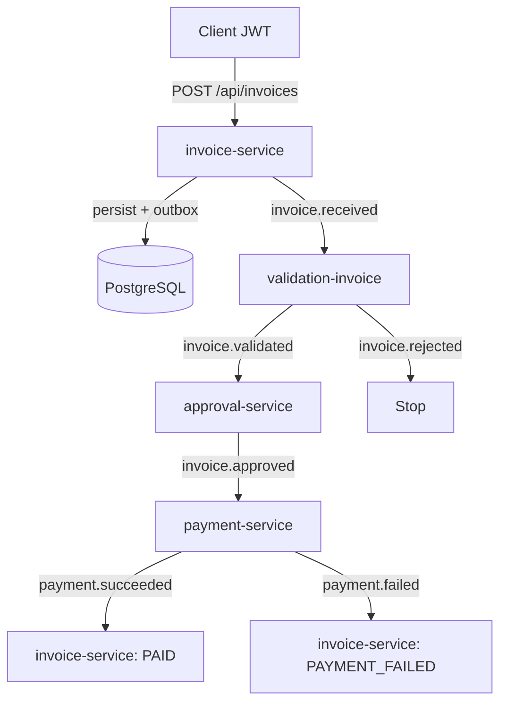

# E-Invoicing Platform

Multi-module, event-driven backend for processing e-invoices (Java 21, Spring Boot).

**Flow:** receive → validate → approve → pay → update invoice status.

Portfolio / learning project aligned with European-style SME invoice workflows. Runtime is **local** (Docker Compose); Azure Bicep under `infra/azure/` is a **target** only.

Repository: https://github.com/asharifi90/e-invoicing

---

## How it works

```text
                    ┌──────────────────┐
                    │  Client (HTTP)   │
                    │  JWT + optional  │
                    │  Idempotency-Key │
                    └────────┬─────────┘
                             │ POST /api/invoices
                             ▼
                    ┌──────────────────┐
                    │ invoice-service  │
                    │ save Postgres    │
                    │ outbox → Kafka   │
                    └────────┬─────────┘
                             │ invoice.received
                             ▼
                    ┌──────────────────┐
                    │ validation-      │
                    │ invoice          │
                    └────────┬─────────┘
                      ┌──────┴──────┐
                      │             │
            invoice.validated   invoice.rejected
                      │             │
                      ▼             ▼
            ┌─────────────────┐   (end)
            │ approval-service│
            │ auto or manual  │
            └────────┬────────┘
                     │ invoice.approved
                     ▼
            ┌─────────────────┐
            │ payment-service │
            │ PSP (simulated) │
            │ + resilience    │
            └────────┬────────┘
              ┌──────┴──────┐
              │             │
   payment.succeeded   payment.failed
              │             │
              ▼             ▼
            ┌─────────────────────────┐
            │ invoice-service         │
            │ status → PAID           │
            │      or PAYMENT_FAILED │
            └─────────────────────────┘
```

### Mermaid (renders on GitHub)



---

## Modules

| Module | Port | Responsibility |
|--------|------|----------------|
| **invoice-service** | 8080 | REST intake, DB, outbox, reacts to payment results |
| **validation-invoice** | 8081 | Business rules on `invoice.received` |
| **approval-service** | 8082 | Auto / manual approval |
| **payment-service** | 8083 | Simulated payment provider |

Architecture style: **hexagonal / DDD-oriented** (domain independent from web, DB, Kafka).

---

## Quick start

### 1. Infrastructure

```bash
docker compose up -d
```

Starts PostgreSQL and Kafka (and Kafka UI if configured in compose).

### 2. Build

```bash
mvn -B clean package -DskipTests
```

### 3. Run each service

```bash
mvn -pl invoice-service spring-boot:run
mvn -pl validation-invoice spring-boot:run
mvn -pl approval-service spring-boot:run
mvn -pl payment-service spring-boot:run
```

### 4. Login + create invoice

```http
POST http://localhost:8080/api/auth/login
Content-Type: application/json

{ "username": "demo", "password": "demo123" }
```

```http
POST http://localhost:8080/api/invoices
Authorization: Bearer <token>
Content-Type: application/json
Idempotency-Key: <optional-uuid>

{
  "invoiceNumber": "INV-2026-001",
  "sellerVatNumber": "BE0123456789",
  "buyerVatNumber": "BE9876543210",
  "lines": [
    {
      "description": "Consulting",
      "quantity": 10,
      "unitPrice": 150.00,
      "currency": "EUR"
    }
  ]
}
```

```http
GET http://localhost:8080/api/invoices/{id}
Authorization: Bearer <token>
```

- Swagger UI: http://localhost:8080/swagger-ui/index.html  
- Demo credentials are for local use only.

---

## Kafka topics

| Topic | Meaning |
|-------|---------|
| `invoice.received` | Invoice stored |
| `invoice.validated` / `invoice.rejected` | Validation outcome |
| `invoice.approved` | Approved (auto or manual) |
| `payment.succeeded` / `payment.failed` | Payment outcome |
| `*.DLT` | Dead-letter after repeated consumer failures |

---

## Reliability (short)

| Concern | Approach |
|---------|----------|
| DB vs Kafka dual-write | Transactional **outbox** (invoice intake; payment results where implemented) |
| Double payment | **Idempotency** on `invoiceId` (`payment_attempt`) |
| Provider errors / slowness | **Resilience4j** (retry, circuit breaker, fallback) |
| Poison messages | **DLQ** on consumers |
| HTTP retries | Optional **Idempotency-Key**; existing invoice number returns same invoice + **status** |
| Tracing in logs | **X-Correlation-Id** |
| Ops signals | Actuator / Micrometer (e.g. outbox published & unpublished) |

Design notes: [`docs/FAILURE_MODES.md`](docs/FAILURE_MODES.md)

---

## Tech stack

| Area | Choice |
|------|--------|
| Language | Java 21 |
| Framework | Spring Boot |
| Architecture | Multi-module, hexagonal-style |
| DB | PostgreSQL + Flyway |
| Messaging | Apache Kafka |
| Security | JWT |
| CI | GitHub Actions |
| Local infra | Docker Compose |
| Cloud (target) | Azure Bicep → App Service (`infra/azure/`) |

---

## Tests & CI

```bash
mvn test
mvn test -pl invoice-service
```

On push/PR to `main`, GitHub Actions runs the build and tests.

---

## Project status

- [x] Full path: intake → validation → approval → payment → PAID / PAYMENT_FAILED  
- [x] Outbox, payment idempotency, Resilience4j, DLQ, correlation id, basic metrics  
- [x] JWT + Swagger on invoice API  
- [x] Azure IaC skeleton (not deployed by default)  
- [ ] Broader integration tests / full monitoring stack (Prometheus/Grafana) as optional next steps  

---

## License / note

Learning and portfolio project. Not production-certified. Do not commit real secrets; demo users and in-memory pieces are for local demos only.
